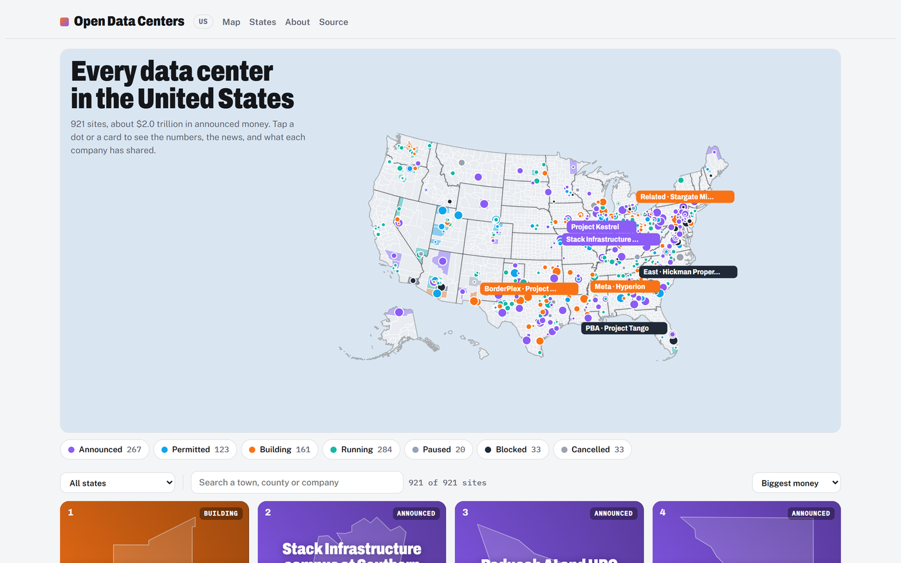
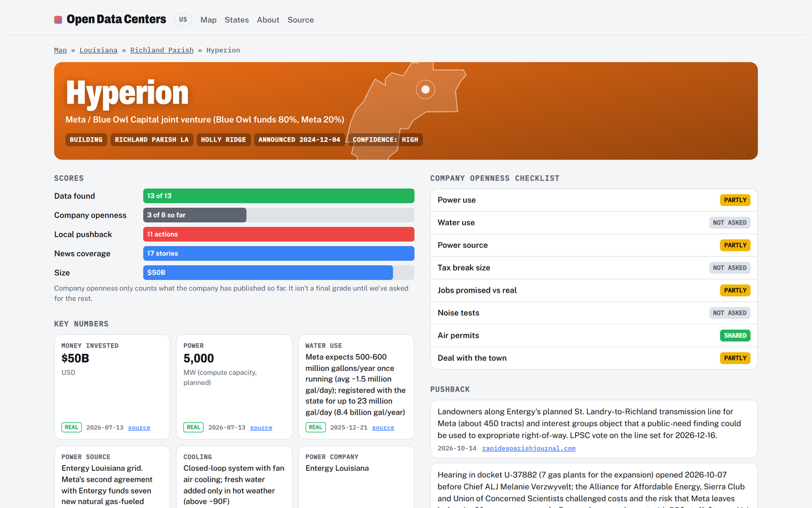
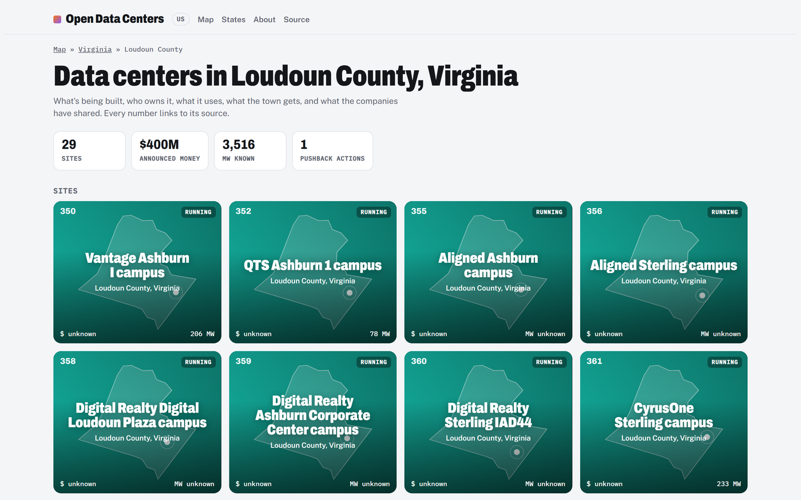
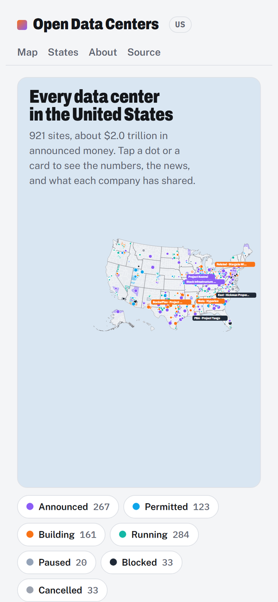

# Open Data Centers

**Every large data center in the United States, on one open map. What it costs the town, what it gives back, and what the company has and hasn't shared.**

[**opendatacenters.vercel.app**](https://opendatacenters.vercel.app)

## Why this exists

AI data centers became one of the biggest local fights in America in 2026. Companies and officials point to jobs, tax revenue and new money for schools. In Louisiana, Meta's Hyperion campus has been pitched on stage with the bonus checks its tax money paid local teachers. Neighbors point to power bills, water, noise and tax deals signed in secret.

Both sides argue without a shared set of facts. Numbers are scattered across utility dockets, permit files, press releases and local papers, and most people never see them.

This project is that shared set of facts: one public page per site, every number sourced and dated, the same yardstick for every company. It doesn't take a side. A county commissioner and a worried neighbor should both be able to trust the same page.

## What you can see

- **A page for every site.** Who owns it, what stage it's at, and how much power, water, money, land and jobs are involved. Every number links to its source and is tagged real or estimate. Unknown stays blank. Nothing is guessed.
- **A company openness score.** The same 8-item checklist for every company: power use, water use, power source, tax break size, jobs promised vs. real, noise tests, air permits, and the deal with the town. "Hidden" only appears after a records request went unanswered.
- **Pushback and news.** Lawsuits, petitions, votes and organized groups, kept apart from general criticism, plus the news for each site.
- **Before and after.** Power bills, rent, home values and wages in the data center's county, next to a look-alike county without one. This shows change, never cause.
- **Every county and state.** A page for each, with the state's tax breaks, utility cases, bills and local moratoriums. A search for "[county] data center" should land on the facts.

## How it's different

| | Open Data Centers | Opposition trackers (e.g. [Data Center Watch](https://www.datacenterwatch.org/)) | Industry directories |
|---|---|---|---|
| Covers | Every large site, fought or not | Projects facing opposition | Colocation for buyers |
| Per-site power, water, jobs, tax breaks | Yes, with sources | No | Partly, unsourced |
| Company openness score | Yes | No | No |
| Open data you can reuse | Yes (CC BY 4.0) | No | No |
| Free | Yes | Reports are free | Mostly paid |

Opposition reports are good sources, and we cite them. This project is the open, per-site record underneath.

## How it stays fresh

The data is kept up by AI agents, each with one job: find new sites, fill in the numbers, track the news, track the pushback, update state laws and utility cases, check that sources still say what we claim, and rebuild the site. They run on a schedule, and every change they make goes through a pull request that a person reviews before it goes live. Agents never publish on their own and never send email.

## Where it stands

- **921 sites** across all 50 states and DC, plus about 430 possible sites waiting for a second source.
- Louisiana and Mississippi are filled in deepest so far. Elsewhere, about half the sites have a power figure and a third have an investment figure. Each routine run fills in more.
- Known gaps are listed openly in [data/SECOND_PASS.md](data/SECOND_PASS.md).

## Help

Know a site we missed, a number that's wrong, or a source that died? [Open an issue](https://github.com/sheikhshessi-10/open-data-centers/issues). Every change needs a source link and a date. To work on the code or the data, see [CONTRIBUTING.md](CONTRIBUTING.md).

## License

Code: [MIT](LICENSE). Data: [CC BY 4.0](data/LICENSE); credit "Open Data Centers" with a link. Map shapes: [us-atlas](https://github.com/topojson/us-atlas) (ISC), from U.S. Census Bureau boundary files.
